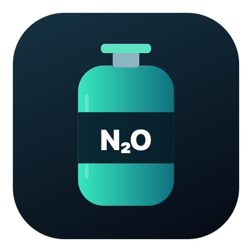

<div align="center">



# N₂O

### Your GPU memory. One slider. The sweet spot.

A small utility that lives next to your clock and puts GPU memory settings a click away.

**SwiftUI on macOS · System tray on Windows · No background services**

[Get started on macOS](#macos) · [Try Windows](#windows--experimental) · [Build from source](#build-from-source) · [FAQ](#faq)

</div>

---

## From the terminal to the menu bar

N₂O started with a simple idea: put this command behind a slider.

```sh
sudo sysctl iogpu.wired_limit_mb=30720
```

Click the bottle in your menu bar, choose a limit, and apply it. The **30,720 MB** preset keeps the setting that inspired the app within easy reach.

The name brings the nitro; the operating system sets the rules. N₂O adjusts the GPU memory limit. Results depend on your hardware, the model or application you run, and the rest of your system’s memory usage.

## What you get

- **Always within reach.** A bottle icon in the macOS menu bar or Windows system tray.
- **Direct control.** A slider and preset access, without typing commands every time.
- **Visible state.** On Mac, a current-value readout and verification after applying changes.
- **Native appearance.** A Mac panel that follows light and dark mode without taking up Dock space.
- **Two implementations.** macOS changes the kernel setting; Windows connects experimentally to Intel’s panel.

## macOS

### Open and adjust

If you already have `N2O.app`, drag it to **Applications** and open it. A small **monochrome bottle** appears in your menu bar.

1. Click the bottle to open the panel.
2. Move the slider in **256 MB** steps, or select **30,720 MB**.
3. Click **Apply limit** and authorize the change in the macOS dialog.
4. N₂O reads the setting again to verify the result.

**System default** selects `0`. Click **Apply limit** to restore it.

### Open at login

With N₂O installed in `/Applications`, run:

```sh
bash scripts/enable-login.sh
```

This installs a per-user LaunchAgent that opens the app when you log in, including after a restart. It does not apply the memory limit automatically.

To disable it:

```sh
launchctl bootout "gui/$(id -u)/local.n2o.gpumemory"
rm ~/Library/LaunchAgents/local.n2o.gpumemory.plist
```

### The sweet spot

The **30,720 MB** preset is the setting chosen for the original Mac with **36 GB of RAM**. It is a shortcut to that configuration, not a universal recommendation.

The slider caps the maximum to leave at least **4 GiB outside the configured limit**. This does not reserve memory for other apps or guarantee free RAM. If the preset exceeds your machine’s allowed maximum, its button is disabled.

### Closing and restarting

- Closing the panel keeps the app in the menu bar. **Quit N₂O** exits it completely.
- The last successfully applied selection is remembered between launches.
- Opening the app does not automatically apply a setting.
- The kernel change resets when you restart your Mac.

The interface requires **macOS 14 or later**; your system must also expose `iogpu.wired_limit_mb`. If that key cannot be read, N₂O displays the error and disables applying changes.

## Windows · Experimental

The Windows version explores shared-memory settings on Intel integrated GPUs, for example a laptop with a **Core Ultra 7 258V, Arc 140V, and 32 GB of RAM**.

> **Current status:** compilation and packaging verified from macOS. The tray interface and Intel connection still need validation on a compatible Windows machine.

### Try it

1. Extract `N2O-Windows-x64.zip` and run `N2O.exe`. .NET is included.
2. Open **Intel Graphics Software** and go to **Shared GPU Memory Override**.
3. In N₂O, click **Connect to Intel**.
4. If it finds one compatible slider, choose a percentage and click **Send selection to Intel**.
5. Review and confirm the setting in Intel. **Restart Windows** for it to take effect.

The icon may be inside the hidden-icons menu next to your clock. Closing the window hides the panel; right-click the icon → **Quit** exits the app.

### What “experimental” means

N₂O uses Windows accessibility to locate Intel’s slider. If the control has an unrecognized name, is not editable, or is ambiguous, N₂O leaves its slider disabled. You can adjust the setting directly in Intel Graphics Software instead.

**Send selection to Intel verifies the value of its UI control; it does not verify the active driver limit.** The Mac preset is not carried over to Windows. The **57%** button represents Intel’s documented default, not an optimized setting for every laptop.

See the [Windows requirements, limitations, and details](windows/README.md).

## Build from source

### Mac · Xcode or Command Line Tools

```sh
bash scripts/build.sh
open build/N2O.app
```

Output: `build/N2O.app`, including its icon and a local ad hoc signature.

### Windows x64 · .NET 10 SDK

From macOS or an environment with Bash, Python 3, and .NET 10:

```sh
bash scripts/build-windows.sh
```

Outputs:

- `build/windows-x64/N2O.exe`: executable with the runtime included.
- `build/N2O-Windows-x64.zip`: portable package with instructions.

To publish directly from Windows with .NET:

```powershell
dotnet publish windows/N2O.Windows.csproj -c Release -r win-x64 --self-contained true -p:PublishSingleFile=true -p:EnableCompressionInSingleFile=true -p:IncludeNativeLibrariesForSelfExtract=true -o build/windows-x64
```

The local Windows executable has no Authenticode signature. Artifacts in `build/` are generated locally and are not included in the repository.

## Under the hood

```text
Sources/N2O.swift           macOS app: panel, menu bar, and sysctl access
windows/Program.cs         Windows app: tray, hardware, and Intel connection
windows/Assets/AppIcon.ico Windows icon
scripts/make-icon.swift    Bottle icon generator
scripts/build.sh           macOS build and packaging
scripts/build-windows.sh   Windows publishing and portable ZIP
```

On Mac, the only privileged command is `/usr/sbin/sysctl -w iogpu.wired_limit_mb=N`, with a validated integer. macOS handles authorization; N₂O does not store passwords or install a privileged service.

On Windows, the app queries hardware and connects to Intel’s visible control. It does not write undocumented registry keys or install its own driver.

## FAQ

**Does this turn RAM into dedicated VRAM?**  
It adjusts a memory usage limit. It does not add physical memory or change your machine’s architecture.

**Does more memory mean more speed?**  
Not necessarily. The goal is to allow a suitable limit for your workload; performance also depends on the GPU, software, and system memory pressure.

**Why does Windows need Intel’s app open?**  
This version connects to its interface. It does not implement a `sysctl` equivalent or have a verified direct driver integration.

**Does it launch at startup?**  
On Mac, run `bash scripts/enable-login.sh` to enable opening at login. Windows startup is not configured. Neither version applies presets automatically at boot.

**How do I undo a change on Mac?**  
Select **System default** and click **Apply limit**. Restarting also resets the setting.

## References

- [MLX: wired limits and the macOS system setting](https://ml-explore.github.io/mlx/build/html/python/_autosummary/mlx.core.set_wired_limit.html).
- [Intel: Shared GPU Memory Override and requirements](https://www.intel.com/content/www/us/en/support/articles/000101789/graphics.html).
- [Intel Graphics Control Library](https://github.com/intel/drivers.gpu.control-library).
- [Microsoft: RangeValuePattern.SetValue](https://learn.microsoft.com/en-us/dotnet/api/system.windows.automation.rangevaluepattern.setvalue).

---

<div align="center">

**N₂O — find your sweet spot.**

</div>
